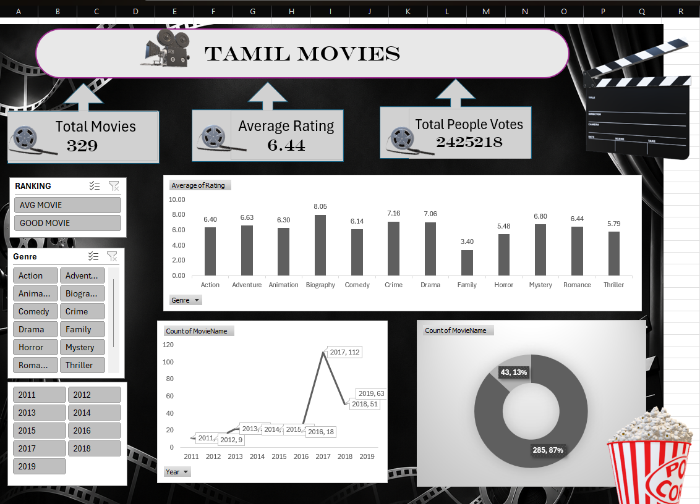

# 🎬 KollywoodLens – Tamil Movies Analytics Dashboard

An interactive **Tamil Cinema Data Analytics Dashboard** built using Microsoft Excel to explore movie performance, ratings, genres, directors, actors, and audience engagement.

## 📊 Project Overview

KollywoodLens transforms Tamil movie data into meaningful insights through an interactive Excel dashboard featuring KPI cards, PivotTables, Pivot Charts, and slicers.

The dashboard helps users explore movie trends, compare ratings, and analyze audience voting patterns across different genres and release years.

## ✨ Key Features

### 📌 KPI Cards
- Total Movies
- Average Movie Rating
- Total People Votes
- Good Movies Count
- Average Hero Rating
- Average Content Rating
- Total Genres
- Highest Movie Rating

### 📈 Data Visualizations
- Genre-wise Average Rating
- Year-wise Movie Release Trends
- Good Movies vs Average Movies
- Director Performance Analysis
- Audience Voting Analysis

### 🎛️ Interactive Filters
- Genre
- Release Year
- Movie Ranking

Explore the dashboard dynamically using slicers.

## 🛠️ Tools & Technologies

| Tool | Purpose |
|---|---|
| Microsoft Excel | Dashboard development |
| PivotTables | Data summarization |
| Pivot Charts | Data visualization |
| Excel Formulas | KPI calculations |
| Slicers | Interactive filtering |

## 📂 Project Structure

```text
KollywoodLens/
│
├── Movies_dashboard.xlsx
├── BG-image.png
├── Dashboard-image.png
└── README.md
```

## 📸 Dashboard Preview



## 🔍 Key Analysis Areas

1. Which movie genres have higher average ratings?
2. How have Tamil movie releases changed over the years?
3. What is the distribution of good and average movies?
4. Which directors and actors have better average ratings?
5. How does audience voting vary across movies?

## 🎯 Project Objectives

- Develop practical Excel data analytics skills.
- Transform raw movie data into meaningful insights.
- Build interactive dashboards using PivotTables and slicers.
- Improve data visualization and business analysis skills.

## 🚀 How to Use

1. Clone or download this repository.
2. Open `Movies_dashboard.xlsx` using Microsoft Excel.
3. Navigate to the Dashboard worksheet.
4. Use the slicers to filter movies by genre, year, and ranking.
5. Explore the KPI cards and charts.

## 👨‍💻 Author

**Sanjay Rahul S**

B.Tech Information Technology Student

Interested in Data Analytics, Artificial Intelligence, and Machine Learning.

---

⭐ If you find this project interesting, consider giving this repository a star!

**Project:** KollywoodLens – Tamil Movies Analytics Dashboard  
**Built with:** Microsoft Excel
